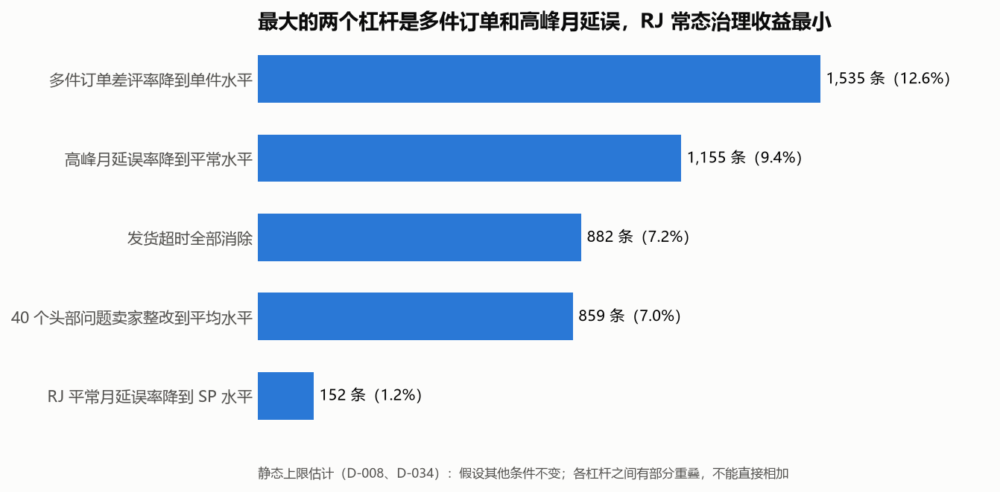
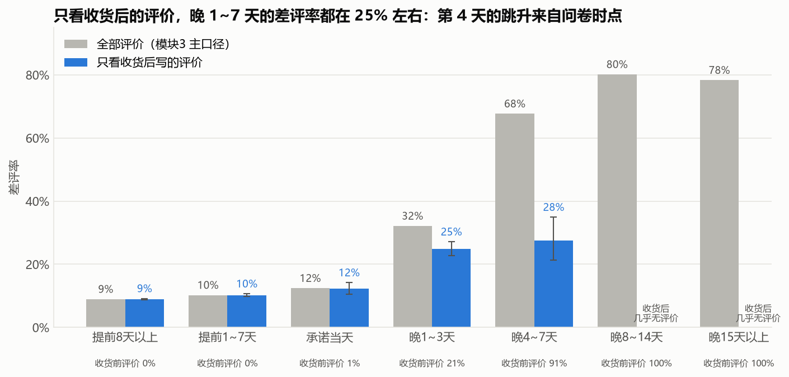
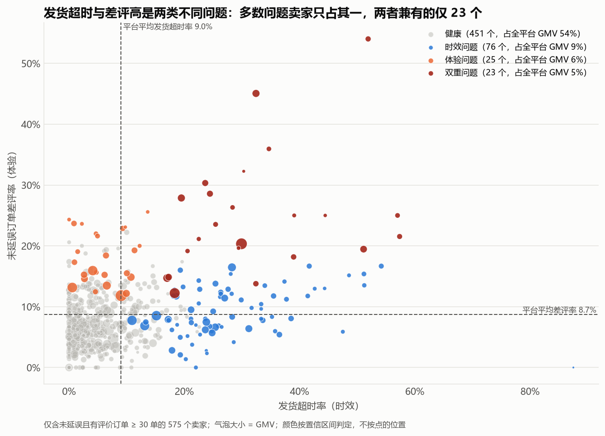
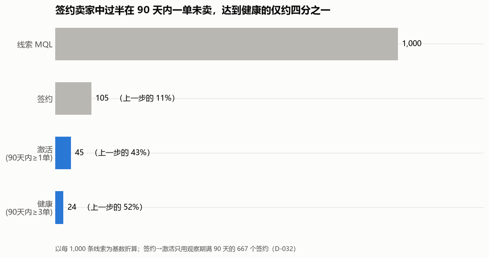

# Olist 平台增长质量与体验诊断

**问题：** Olist 在保持交易规模增长的同时，如何提升买家满意度和卖家质量？哪些改进最值得做？（项目没有成本数据，以产出和实施难度衡量）

📄 **分析报告：[docs/report/olist_report.pdf](docs/report/olist_report.pdf)**（约 10 页，结论、证据与建议）

## 1. 三条核心结论

1. **进入 2018 年后增长停滞，受需求限制。** 2018 年 1~8 月 GMV 是上年同期的 2.41 倍，但这来自 2017 年的爬坡；进入 2018 年后，月度买家数和 GMV 不再增长，复购率只有约 2%；同期活跃卖家增加 32%，每卖家 GMV 下降 31%，新卖家占活跃卖家的 54%，只贡献 30% 的 GMV。
2. **约四成差评（按全部评价口径；只看收货后评价约两成）来自两个可以改进的机制，差评也会压低卖家之后的销量。**
   - **承诺日期没有兑现**（约 28% 的差评，只看收货后评价约 8%）：满意度问卷在承诺送达日发出，货没到就容易得到差评，晚几天差别不大；延误集中的 3 个月是物流变慢、承诺没有跟着放宽造成的
   - **多件订单收货不完整**（约 13% 的差评）：约六成的多件订单差评评论在说缺件或只收到部分商品
   - 同一卖家差评率高 10 个百分点，下个月 GMV 约低 4%~10%
3. **最值得先做的改进**：多件订单完整交付（可减少约 1,165~1,535 条差评，单项最大）；头部问题卖家整改和发货超时治理（难度低、结果确定）；承诺日期按运输时长动态校准。RJ 的常态物流治理收益最小。



## 2. 项目介绍
本项目基于 Olist 巴西电商公开数据集（约 10 万笔订单，2016-2018）和营销漏斗数据集，以 Olist 内部数据团队的视角，分析平台增长、买家留存、买家满意度、卖家质量和卖家获取五个方向，通过 SQL 数仓建模和统计分析找出影响业务的关键因素，并给出可执行、可量化的建议。

## 3. 分析过程中的一次重要修正

写报告时，我对每个准备写进报告的说法做了回头检验（`python/s2_report_checks.ipynb`），推翻了两处早期解释：

- 早期发现"延误第 4 天是差评临界点"，检验后发现，跳升的位置正是评价改为在收货前写的位置。只看收货后的评价，晚 1~3 天与晚 4~7 天差别不显著。建议因此从"第 3 天主动干预"改为"保证承诺日期能兑现"
- 早期把延误集中的 3 个月称为"高峰月"并建议准备运力，检验后发现其中 2 个月订单量并不高，原因是运输变慢而承诺没有跟着放宽



## 4. 分析框架

| 模块 | 问题 | 主要方法 |
|---|---|---|
| 模块1 KPI 拆解 | GMV 增长来自哪个因子？ | KPI 树（买家数 × 人均订单数 × 客单价） |
| 模块3 履约与满意度 | 什么导致差评？问题集中在哪里？ | 分段分析、2×2 交叉、两比例 z 检验、敏感性分析 |
| 模块5 复购 | 买家会回来吗？ | 两种复购口径对比、右删失检验 |
| 模块6 卖家分层 | 如何分层管理卖家？ | 帕累托分析、置信区间判定、卖家内部对比、Bootstrap |
| 模块7 卖家获取漏斗 | 新卖家能否真正经营？ | 漏斗折算、观察窗口处理、渠道质量对比 |
| 报告阶段回头检验 | 准备写进报告的说法站得住吗？ | 卖家 × 月份固定效应、卖家侧拆解、评价时点分析、评论文本分析、多重比较校正 |
| 杠杆测算 | 哪些改进最值得做？ | 统一换算为可减少的差评数（下限 ~ 上限）并附 GMV 换算；按实施难度排序（缺少成本数据） |



## 5. 技术亮点

- **数据分层建模**：ODS → DWD → DWS → ADS 四层；DWD 层"只打标记、不删数据"，便于敏感性分析
- **数据质量审计**：完整性、唯一性、参照完整性、逻辑一致性、分布五类约 40 项检查；发现并修复了 CSV 导入时的静默丢行、邮编坐标落在巴西境外等问题
- **决策可追溯**：39 条口径决策全部记录在 [决策日志](docs/decision_log.md)，每条包含理由和被否决的方案
- **偏差控制**：识别并处理右删失、无应答偏差、混杂因素，并主动检验了"体验差导致复购低"这一看似合理的假设（结论：影响很小）
- **统计推断**：两比例 z 检验、置信区间、Bootstrap、固定效应回归、精确二项检验与多重比较校正（BH）
- **文本分析**：葡萄牙语评论的词频比较、关键词规则与人工抽查
- **稳健性检验**：模块3、6、7 做了系统的敏感性分析（替换口径、调整阈值、按时期拆分），并如实报告了对结论幅度影响较大的口径；写报告前对结论做了回头检验，推翻的解释保留记录而不是悄悄删除

**技术栈**：MySQL（窗口函数、CTE、多层建模）· Python（pandas、matplotlib、scipy）· Jupyter · Git



## 6. 数据来源
本项目使用以下公开数据集：

- Brazilian E-Commerce Public Dataset by Olist

  https://www.kaggle.com/datasets/olistbr/brazilian-ecommerce

- Marketing Funnel by Olist

  https://www.kaggle.com/datasets/olistbr/marketing-funnel-olist

## 7. 仓库结构

```
olist-analytics/
├── sql/
│   ├── 00_data_quality_checks.sql            # 数据质量审计（A~E 五类约 40 项检查）
│   ├── s1_review_investigation.sql           # 专项调查：评价与订单的多对多关系
│   ├── 01_ods/                               # 原始数据层：建表、导入（含营销漏斗数据）
│   ├── 02_dwd/                               # 明细层：清洗与打标记
│   ├── 03_dws/                               # 汇总层：履约宽表、卖家宽表、漏斗宽表
│   └── 04_ads/                               # 应用层：模块1、5 的查询，模块6 的分层结果表
├── python/
│   ├── olist_utils.py                        # 数据库连接与统一图表风格
│   ├── s1_overview.ipynb                     # 阶段1 数据全景概览
│   ├── m1_kpi_tree.ipynb                     # 模块1 KPI 拆解
│   ├── m3_fulfillment.ipynb                  # 模块3 履约与满意度
│   ├── m5_repurchase.ipynb                   # 模块5 复购
│   ├── m6_seller.ipynb                       # 模块6 卖家分层
│   ├── m7_funnel.ipynb                       # 模块7 卖家获取漏斗
│   ├── s2_report_checks.ipynb                # 阶段2 写报告时的回头检验
│   └── s2_impact_sizing.ipynb                # 阶段2 杠杆测算（统一口径）
├── docs/
│   ├── project_charter.md                    # 项目章程：目标、框架、规范
│   ├── data_dictionary.md                    # 数据字典：原始表与派生表
│   ├── er_diagram.png                        # 原始数据 ER 图
│   ├── dq_results.txt                        # 数据质量审计的运行结果
│   ├── decision_log.md                       # 决策日志（D-001 ~ D-039）
│   ├── metric_definitions.md                 # 指标口径
│   ├── stage_summaries/                      # 阶段总结
│   ├── report/                               # 分析报告（PDF）
│   └── figures/                              # 图表（fig* 为阶段1 概览，m* 为各模块，s2* 为阶段2 综合）
└── requirements.txt                          # Python 依赖
```

## 8. 如何复现

**环境**：MySQL 8.0 及以上（本项目使用 26.7），Python 3.13。

1. **准备数据**：从 Kaggle 下载上述两个数据集，按以下目录存放（文件夹名不含空格，D-010）：
   ```
   data/raw/Brazilian_eCommerce/          # 主数据集的 9 个 CSV
   data/raw/Marketing_Funnel_by_Olist/    # 营销漏斗的 2 个 CSV
   ```
2. **开启本地文件导入**（只需一次）：在 MySQL 中执行 `SET GLOBAL local_infile = 1;`
3. **建库建表**：在项目根目录启动客户端
   `mysql -u root -p --local-infile=1 --default-character-set=utf8mb4`，然后按顺序执行：
   ```
   SOURCE sql/01_ods/01_create_ods_tables.sql;
   SOURCE sql/01_ods/02_load_ods_data.sql;
   SOURCE sql/02_dwd/01_create_dwd_tables.sql;
   SOURCE sql/03_dws/01_create_dws_order_fulfillment.sql;
   SOURCE sql/03_dws/02_create_dws_seller.sql;
   SOURCE sql/03_dws/03_create_dws_seller_funnel.sql;
   SOURCE sql/04_ads/m6_seller_tier.sql;
   ```
   每个脚本末尾的核对查询可以用来确认结果（例如履约宽表应为 96,203 行）。
4. **配置 Python**：`pip install -r requirements.txt`；在项目根目录创建 `.env` 文件，写入 `MYSQL_PASSWORD=你的密码`（已在 `.gitignore` 中，不会被提交）。代码默认以 `root` 用户连接本机 3306 端口，如有不同请修改 `python/olist_utils.py`。
5. **运行分析**：在 `python/` 目录下打开 notebook，从头运行即可。建议顺序：`s1_overview` → `m1` → `m5` → `m3` → `m6` → `m7` → `s2_report_checks` → `s2_impact_sizing`。

## 9. 当前状态

- **阶段1（数据准备与质量审计）已完成**：两个数据集共 11 张表已导入 MySQL，完成数据质量审计、DWD 层清洗和数据全景概览。阶段总结见 `docs/stage_summaries/stage_1.md`。
- **阶段2（核心业务分析）已完成**：完成模块1、3、5、6、7 的分析，各模块均给出结论、局限与业务建议；写报告时做了一轮回头检验，并完成分析报告。阶段总结见 `docs/stage_summaries/stage_2.md`。
- 所有口径决策见 `docs/decision_log.md`。

**后续计划**：剩余约六成差评的原因拆解（评论文本）、品类质量分析、完整的复购 cohort 分析、GMV 增长归因（LMDI）、SQL 性能优化、Tableau 仪表盘。

**局限**：数据为 2016-2018 年的公开样本；部分结论（如获客渠道的预算分配）缺少成本数据支撑。