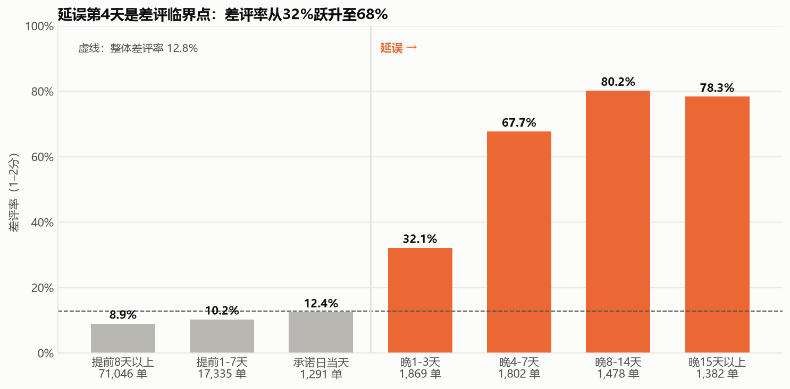

# Olist Analytics Project

## 1. 项目介绍
本项目基于 Olist 巴西电商公开数据集（约 10 万笔订单，2016-2018），模拟数据分析团队对电商平台运营情况进行分析。

项目关注平台增长、买家留存、用户满意度、卖家质量以及卖家获取五个方向，通过 SQL 数仓建模和数据分析方法，发现影响业务表现的关键因素，并给出可执行的业务建议。

## 2. 项目目标
本项目主要回答以下问题：

- 平台交易增长的主要来源是什么？
- 买家是否会重复购买？
- 哪些因素影响买家满意度？问题集中在哪里？
- 如何评价卖家质量并识别潜在问题卖家？
- 新签约的卖家能否真正开始经营？哪个获客渠道带来的卖家质量最好？

## 3. 核心发现

1. **增长完全依赖拉新**：GMV 增长几乎全部来自买家数增长，人均订单数（约 1.01）和客单价（约 138 BRL）基本不变；买家复购率只有约 2%
2. **延误是差评的最强驱动因素**：延误订单差评率 62%，是准时订单的 6.8 倍（排除收货前填写的评价后仍为 2.7 倍）；延误第 4 天是差评率跃升的临界点（32% → 68%）
3. **延误高度集中**：72% 的延误来自物流环节；RJ 一个州贡献了全国 23% 的延误订单
4. **卖家问题集中且可治理**：前 1% 的卖家贡献 26% 的 GMV；发货超时与差评高是两类基本不重叠的问题，40 个头部问题卖家贡献了最多的超额差评
5. **签约不等于经营**：57% 的签约卖家 90 天内一单未卖；付费搜索与自然搜索签约率相同，但签约后激活率高 16 个百分点



## 4. 分析框架

| 模块 | 问题 | 主要方法 |
|---|---|---|
| 模块1 KPI 拆解 | GMV 增长来自哪个因子？ | KPI 树（买家数 × 人均订单数 × 客单价） |
| 模块3 履约与满意度 | 什么导致差评？问题集中在哪里？ | 分段分析、2×2 交叉、两比例 z 检验、敏感性分析 |
| 模块5 复购 | 买家会回来吗？ | 两种复购口径对比、右删失检验 |
| 模块6 卖家分层 | 如何分层管理卖家？ | 帕累托分析、置信区间判定、卖家内部对比、Bootstrap |
| 模块7 卖家获取漏斗 | 新卖家能否真正经营？ | 漏斗折算、观察窗口处理、渠道质量对比 |


## 5. 技术亮点

- **数据分层建模**：ODS → DWD → DWS → ADS 四层；DWD 层"只打标记、不删数据"，便于敏感性分析
- **数据质量审计**：完整性、唯一性、参照完整性、逻辑一致性、分布五类约 40 项检查；发现并修复了 CSV 导入时的静默丢行、邮编坐标落在巴西境外等问题
- **决策可追溯**：31 条口径决策全部记录在 [决策日志](docs/decision_log.md)，每条包含理由和被否决的方案
- **偏差控制**：识别并处理右删失、无应答偏差、混杂因素
- **统计推断**：两比例 z 检验、置信区间、Bootstrap
- **稳健性检验**：模块3、6 做了系统的敏感性分析（替换口径、调整阈值），并如实报告了对结论幅度影响较大的口径

**技术栈**：MySQL（窗口函数、CTE、多层建模）· Python（pandas、matplotlib、scipy）· Jupyter · Git


## 6. 数据来源
本项目使用以下公开数据集：

- Brazilian E-Commerce Public Dataset by Olist

  https://www.kaggle.com/datasets/olistbr/brazilian-ecommerce

- Marketing Funnel by Olist

  https://www.kaggle.com/datasets/olistbr/marketing-funnel-olist

## 7. 仓库结构

```
olist-analytics/
├── sql/
│   ├── 00_data_quality_checks.sql            # 数据质量审计（A~E 五类约 40 项检查）
│   ├── s1_review_investigation.sql           # 专项调查：评价与订单的多对多关系
│   ├── 01_ods/                               # 原始数据层：建表、导入（含营销漏斗数据）
│   ├── 02_dwd/                               # 明细层：清洗与打标记
│   ├── 03_dws/                               # 汇总层：履约宽表、卖家宽表、漏斗宽表
│   └── 04_ads/                               # 应用层：模块1、5 的查询，模块6 的分层结果表
├── python/
│   ├── olist_utils.py                        # 数据库连接与统一图表风格
│   ├── s1_overview.ipynb                     # 阶段1 数据全景概览
│   ├── m1_kpi_tree.ipynb                     # 模块1 KPI 拆解
│   ├── m3_fulfillment.ipynb                  # 模块3 履约与满意度
│   ├── m5_repurchase.ipynb                   # 模块5 复购
│   ├── m6_seller.ipynb                       # 模块6 卖家分层
│   └── m7_funnel.ipynb                       # 模块7 卖家获取漏斗
├── docs/
│   ├── project_charter.md                    # 项目章程：目标、框架、规范
│   ├── data_dictionary.md                    # 数据字典：原始表与派生表
│   ├── er_diagram.png                        # 原始数据 ER 图
│   ├── dq_results.txt                        # 数据质量审计的运行结果
│   ├── decision_log.md                       # 决策日志（D-001 ~ D-031）
│   ├── metric_definitions.md                 # 指标口径
│   ├── stage_summaries/                      # 阶段总结
│   └── figures/                              # 图表（fig* 为阶段1 概览，m* 为各模块）
└── requirements.txt                          # Python 依赖
```

## 8. 如何复现

**环境**：MySQL 8.0 及以上（本项目使用 26.7），Python 3.13。

1. **准备数据**：从 Kaggle 下载上述两个数据集，按以下目录存放（文件夹名不含空格，D-010）：
   ```
   data/raw/Brazilian_eCommerce/          # 主数据集的 9 个 CSV
   data/raw/Marketing_Funnel_by_Olist/    # 营销漏斗的 2 个 CSV
   ```
2. **开启本地文件导入**（只需一次）：在 MySQL 中执行 `SET GLOBAL local_infile = 1;`
3. **建库建表**：在项目根目录启动客户端
   `mysql -u root -p --local-infile=1 --default-character-set=utf8mb4`，然后按顺序执行：
   ```
   SOURCE sql/01_ods/01_create_ods_tables.sql;
   SOURCE sql/01_ods/02_load_ods_data.sql;
   SOURCE sql/02_dwd/01_create_dwd_tables.sql;
   SOURCE sql/03_dws/01_create_dws_order_fulfillment.sql;
   SOURCE sql/03_dws/02_create_dws_seller.sql;
   SOURCE sql/03_dws/03_create_dws_seller_funnel.sql;
   SOURCE sql/04_ads/m6_seller_tier.sql;
   ```
   每个脚本末尾的核对查询可以用来确认结果（例如履约宽表应为 96,203 行）。
4. **配置 Python**：`pip install -r requirements.txt`；在项目根目录创建 `.env` 文件，写入 `MYSQL_PASSWORD=你的密码`（已在 `.gitignore` 中，不会被提交）。代码默认以 `root` 用户连接本机 3306 端口，如有不同请修改 `python/olist_utils.py`。
5. **运行分析**：在 `python/` 目录下打开 notebook，从头运行即可。建议顺序：`s1_overview` → `m1` → `m5` → `m3` → `m6` → `m7`。

## 9. 当前状态

- **阶段1（数据准备与质量审计）已完成**：两个数据集共 11 张表已导入 MySQL，完成数据质量审计、DWD 层清洗和数据全景概览。阶段总结见 `docs/stage_summaries/stage_1.md`。
- **阶段2（核心业务分析）已完成**：完成模块1、3、5、6、7 的分析，各模块均给出结论、局限与业务建议。阶段总结见 `docs/stage_summaries/stage_2.md`。
- 所有口径决策见 `docs/decision_log.md`。

**后续计划**：GMV 增长归因（LMDI）、品类质量分析、完整的复购 cohort 分析、SQL 性能优化、Tableau 仪表盘。

**局限**：数据为 2016-2018 年的公开样本；部分结论（如获客渠道的预算分配）缺少成本数据支撑。