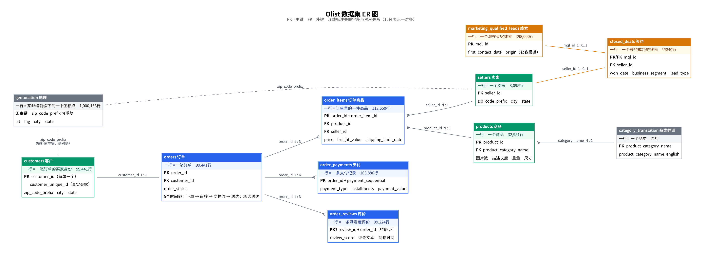

# 数据字典

> 版本：v0.1 初稿（2026-10-10）。主键与关联关系基于 Kaggle 数据说明和人工查看数据得出，标注"待验证"的项目将在步骤1.6数据质量审计中确认。

## 1. 表概览

两个数据集共11张表，按用途分为四组。

| 分组 | 表名 | 一行代表什么（粒度） | 主键 | 关联 | 记录数 |
| --- | --- | --- | --- | --- | ---: |
| 订单核心 | olist_orders_dataset | 一笔订单 | order_id | customer_id → customers | 99,441 |
| 订单核心 | olist_order_items_dataset | 订单里的**一件**商品（买2件 = 2行） | order_id + order_item_id | order_id → orders；product_id → products；seller_id → sellers | 112,650 |
| 订单核心 | olist_order_payments_dataset | 一笔订单的一条支付记录 | order_id + payment_sequential | order_id → orders | 103,886 |
| 订单核心 | olist_order_reviews_dataset | 一条满意度评价 | review_id + order_id（待验证） | order_id → orders | 99,224 |
| 参与者 | olist_customers_dataset | 一笔订单对应的买家身份 | customer_id | customer_zip_code_prefix → geolocation | 99,441 |
| 参与者 | olist_sellers_dataset | 一个卖家 | seller_id | seller_zip_code_prefix → geolocation | 3,095 |
| 参与者 | olist_products_dataset | 一个商品 | product_id | product_category_name → translation | 32,951 |
| 参考 | product_category_name_translation | 一个品类 | product_category_name | — | 71 |
| 参考 | olist_geolocation_dataset | 某个邮编前缀下的一个坐标点 | 无（邮编前缀可重复） | 被 customers、sellers 通过邮编前缀关联 | 1,000,163 |
| 营销漏斗 | olist_marketing_qualified_leads_dataset | 一条营销合格线索（一个潜在卖家） | mql_id | — | 8,000 |
| 营销漏斗 | olist_closed_deals_dataset | 一条签约成功的线索 | mql_id | mql_id → leads；seller_id → sellers | 842 |

记录数指数据行数（不含表头）。注意：用"数文件行数"的方法得到的数字可能比记录数大，原因将在步骤1.5揭晓。

## 2. 各表的关键字段

### orders 订单
订单的五个时间戳串起了履约全过程，是模块3的核心：

| 字段 | 含义 |
| --- | --- |
| order_purchase_timestamp | 下单时间 |
| order_approved_at | 支付审核通过时间 |
| order_delivered_carrier_date | 卖家把货交给物流的时间 |
| order_delivered_customer_date | 买家实际收货时间 |
| order_estimated_delivery_date | 下单时向买家承诺的送达日期 |
| order_status | 订单状态：delivered、shipped、canceled 等 |

### order_items 订单商品
| 字段 | 含义 |
| --- | --- |
| order_item_id | 订单内商品序号，从1开始。没有"数量"字段，同一商品买几件就有几行 |
| shipping_limit_date | 卖家必须把货交给物流的截止时间，用于判断卖家是否发货超时 |
| price | 这一件商品的价格（雷亚尔） |
| freight_value | 分摊到这一件商品的运费 |

### customers 客户
| 字段 | 含义 |
| --- | --- |
| customer_id | **每笔订单生成一个新ID**，同一个人下两单会有两个 customer_id |
| customer_unique_id | 识别真实买家的ID。计算买家数、复购率必须用它 |

### order_reviews 评价
| 字段 | 含义 |
| --- | --- |
| review_score | 1–5分 |
| review_creation_date | 系统向买家发送满意度问卷的日期 |
| review_answer_timestamp | 买家回答问卷的时间 |

### closed_deals 签约
| 字段 | 含义 |
| --- | --- |
| won_date | 签约时间 |
| business_segment | 卖家所属行业 |
| lead_type | 线索类型 |

### marketing_qualified_leads 线索
| 字段 | 含义 |
| --- | --- |
| first_contact_date | 首次接触日期 |
| origin | 获客渠道，例如自然搜索、付费搜索、社交媒体 |

## 3. 待验证的问题

以下问题将在步骤1.6的数据质量审计中逐一检查：

- [ ] 评价表的 review_id 是否唯一？一笔订单是否可能有多条评价？
- [ ] 一笔订单是否可能包含多个卖家的商品？
- [ ] 客户表、卖家表的邮编前缀能否都在地理表中找到？
- [ ] 订单的时间戳先后顺序是否都合理？
- [ ] 支付金额是否等于商品价格加运费？